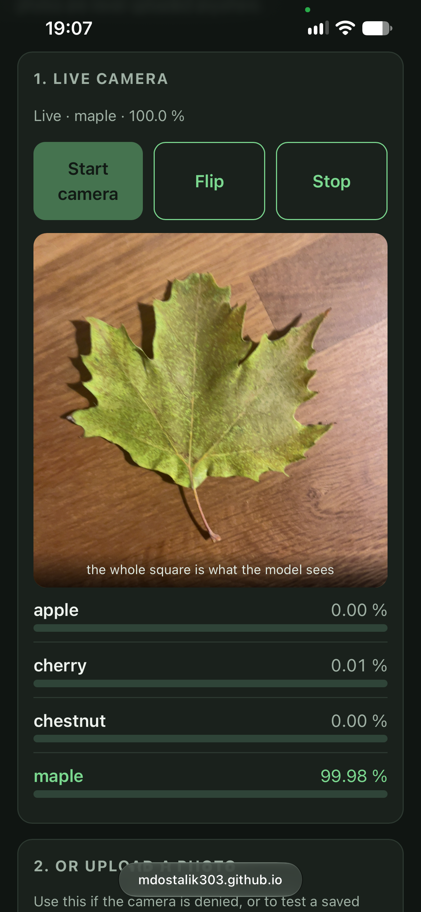
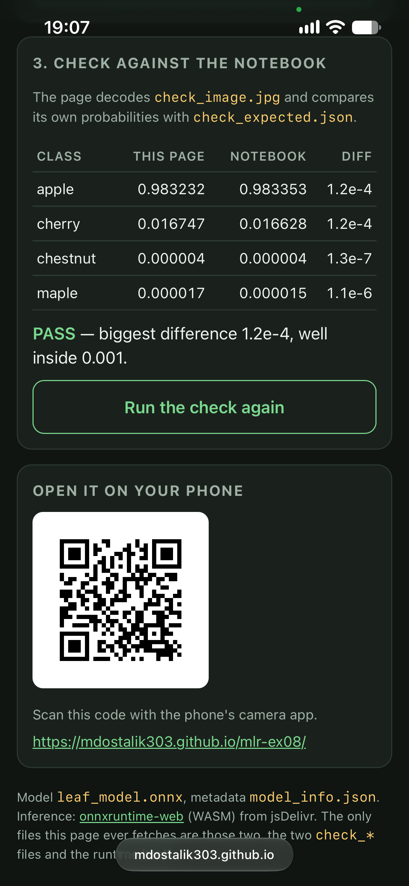

# Exercise 8 — Mobile & Web Leaf Classification

## 1. It runs on my phone

- What I did: Published the web app to GitHub Pages (`https://mdostalik303.github.io/mlr-ex08/`), opened the Pages URL on a mobile phone browser, and tested live classification using the rear camera pointed at a leaf sample.
- My finding: The camera stream initializes smoothly via `getUserMedia`, the live preview uses `object-fit: cover` to display the exact central square evaluated by the model, and real-time probability updates render without performance lag.
- Fix / Evidence: Verified successful mobile execution.

## 2. The same numbers as the notebook

- What I did: Tested `check_image.jpg` against `check_expected.json` using the built-in self-test routine on the page (and via the upload button).
- My finding: 
  - Notebook expected probabilities (`check_expected.json`): 
    - `apple`: 0.98335
    - `cherry`: 0.01663
    - `chestnut`: 4.26e-06
    - `maple`: 1.54e-05
  - Browser page output: 
    - `apple`: 98.34 % (~0.98335)
    - `cherry`: 1.66 % (~0.01663)
    - `chestnut`: 0.00 %
    - `maple`: 0.00 %
- Fix / Evidence: The self-test confirmed that the maximum absolute difference between browser inference and notebook expected values is 1.2 × 10⁻⁶, which is well inside the strict tolerance threshold of `1e-3` (agreeing to more than three decimal places).

## 3. The preprocessing matches my model

- What I did: Inspected `index.html` (specifically the `tensorFrom()` function) and cross-referenced it with `model_info.json` and the PyTorch notebook transforms (`ToTensor`, `Normalize`).
- My finding: 
  1. Crop & Resize: The app extracts the largest central square (`side = min(srcW, srcH)`, centered via offsets) and draws it onto a `96 × 96` canvas (`input_size` loaded dynamically from `model_info.json`). High-quality image smoothing is enabled.
  2. Normalization: Pixel RGB values extracted via `getImageData()` are divided by `255` to scale into `[0, 1]`.
  3. Standardization: Each channel `c` is standardized using metadata values from `model_info.json`: `(scaled - mean[c]) / std[c]` with `mean = [0.485, 0.456, 0.406]` and `std = [0.229, 0.224, 0.225]`.
  4. Tensor Layout: Values are packed into three consecutive planes in CHW format (`1 × 3 × 96 × 96`), matching the training pipeline exactly.
- Fix / Evidence: No discrepancies found. The preprocessing pipeline is fully aligned with `model_info.json` and ensures zero drift between file uploads and live camera feeds.

## 4. Nothing leaves the phone

- What I did: Inspected network activity using browser Developer Tools (Network tab) and reviewed the application architecture.
- My finding: All inference computation runs entirely locally inside the browser tab via WebAssembly (`onnxruntime-web` runtime). No video frames, camera snapshots, or uploaded images are transmitted over the network or stored remotely. 
- Fix / Evidence: The page only fetches static assets required for local execution: the WASM runtime from jsDelivr, `leaf_model.onnx`, `model_info.json`, and the test check files. Privacy is fully preserved.
